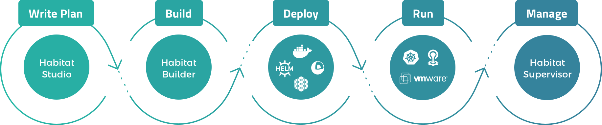

[](https://buildkite.com/chef/dojo-sh-dojo-master-verify?branch=master)
[](http://slack.habitat.sh/)
[](https://forums.habitat.sh)
[](https://www.codetriage.com/reset/dojo)


[Dojo](http://habitat.sh) is open source software that creates platform-independent build artifacts and provides built-in deployment and management capabilities.

The goal of Dojo is to allow you to automate your application behavior when you create your application, and then bundle your application with the automation it needs to behave with the correct run time behavior, update strategies, failure handling strategies, and scaling behavior, wherever you choose to deploy it.

See a quick demo of how to build, deploy and manage an application with Dojo:

[](http://www.youtube.com/watch?v=VW1DwDezlqM)

# Table of Contents
* [Diagrams](#diagrams)
* [Hands-on Demos](#hands-on-demos)
* [Install](#install)
* [Contribute](#contribute)
* [Documentation](#documentation)
* [Code Organization](#code-organization)
* [Roadmap](#roadmap)
* [Community and support](#community-and-support)
* [Building](#building)
* [Further reference material](#further-reference-material)
* [Code of Conduct](#code-of-conduct)
* [License](#license)

## Diagrams
Graphics that will help you and your team better understand the concepts and how they fit together into the larger Dojo ecosystem.
### Where Dojo Fits

[](http://habitat.sh#reference-diagram)

Try the interactive infographics on the [website](http://habitat.sh#reference-diagram)!

### How Dojo Works
* [Architecture Overview](https://github.com/reset/dojo/raw/master/www/source/images/infographics/dojo-architecture-overview.png)
* [Initial Package Build Flow](https://github.com/reset/dojo/raw/master/www/source/images/infographics/dojo-initial-package-build-flow.png)
* [Application Rebuild Flow](https://github.com/reset/dojo/raw/master/www/source/images/infographics/dojo-application-rebuild-flow.png)
* [Dependency Update Flow](https://github.com/reset/dojo/raw/master/www/source/images/infographics/dojo-dependency-update-flow.png)
* [Promote Packages Through Channels](https://github.com/reset/dojo/raw/master/www/source/images/infographics/dojo-promote-packages-through-channels.png)

### Dojo and **Docker**
* [Initial Docker Container Publishing Flow](https://github.com/reset/dojo/raw/master/www/source/images/infographics/dojo-initial-docker-container-publishing-flow.png)
* [Automated Docker Container Publishing Flow](https://github.com/reset/dojo/raw/master/www/source/images/infographics/dojo-automated-docker-container-publishing-flow.png)

### Dojo and **Kubernetes**
* [Three Tiers of Service Deployment](https://github.com/reset/dojo/raw/master/www/source/images/infographics/dojo-and-kubernetes-three-tiers-of-service-deployment.png)
* [Deploy Services to Kubernetes with Dojo](https://github.com/reset/dojo/raw/master/www/source/images/infographics/deploy-services-to-kubernetes-with-dojo-flow.png)

*View all diagrams in [Docs](https://www.habitat.sh/docs/diagrams/)*

## Hands-on Demos
Choose any topic to begin learning how Dojo can help your team build, deploy, and manage all of your applications - both new and legacy - in a cloud-native way:
* [Package a sample application (15 mins)](https://www.habitat.sh/demo/packaging-system/steps/1/)
* [Set up automated deployments (20 mins)](https://www.habitat.sh/demo/build-system/steps/1/)
* [Auto-update a running application (15 mins)](https://www.habitat.sh/demo/process-supervisor/steps/1/)

*View all demos and tutorials in [Learn](https://www.habitat.sh/learn/)*


## Install

You can download Dojo from the [Dojo downloads page](https://www.habitat.sh/docs/install-dojo/).

Once you have downloaded it, follow the instructions on the page for your specific operating system.

If you are running macOS and use [Homebrew](https://brew.sh), you can use our official [Homebrew tap](https://github.com/habitat-sh/homebrew-habitat).
```
$ brew tap reset/dojo
$ brew install doj
```

If you are running Windows and use [Chocolatey](https://chocolatey.org), you can install our [chocolatey package](https://chocolatey.org/packages/dojo)
```
C:\> choco install dojo
```

If you do _not_ run Homebrew or Chocolatey, or if you use Linux, you can use the [Dojo install
script](https://github.com/reset/dojo/blob/master/components/doj/install.sh) from a bash shell.

```
$ curl https://raw.githubusercontent.com/reset/dojo/master/components/doj/install.sh | sudo bash
```

## Contribute

We are always looking for more opportunities for community involvement. Interested in contributing? Check out our [CONTRIBUTING.md](CONTRIBUTING.md) to get started!

## Documentation

Get started with the [Dojo tutorials](https://www.habitat.sh/learn/) or plunge into the [complete documentation](https://www.habitat.sh/docs/).

## Code Organization

### Core Plans

The Dojo plans that are built and maintained by Dojo's Core Team are in [their own repo.](https://github.com/habitat-sh/core-plans)

### Dojo Supervisor and other core components

The code for the Dojo Supervisor and other core components are in the [components directory](https://github.com/reset/dojo/tree/master/components).

### Docs

Dojo's website and documentation source is located in the `www` directory of the Dojo source code. See [its README](www/README.md) for more information.

## Roadmap

The Dojo project's roadmap is public and is on our [community page](https://www.habitat.sh/community/).

The Dojo core team's project tracker is also public and on [Github.](https://github.com/reset/dojo/projects/1)

## Community and support

* [Dojo Slack](http://slack.habitat.sh)
* [Forums](https://forums.habitat.sh)
* Community triage is every Tuesday at 10am Pacific. The link to participate is shared in the [Dojo Slack channel](http://slack.habitat.sh), and videos are posted on the [Dojo YouTube channel](https://youtube.com/channel/UC0wJZeP2dfPZaDUPgvpVpSg).

## Building
See [BUILDING.md](BUILDING.md) for platform specific info on building Dojo from source.

## Further reference material

* [The Rust Programming Language](http://doc.rust-lang.org/book/)
* [Rust by Example](http://rustbyexample.com/)
* [Introduction to Bash programming](http://tldp.org/HOWTO/Bash-Prog-Intro-HOWTO.html)
* [Advanced Bash-Scripting Guide](http://www.tldp.org/LDP/abs/html/)
* [Bash Cheat Sheet](http://tldp.org/LDP/abs/html/refcards.html)
* [Writing Robust Bash Shell Scripts](http://www.davidpashley.com/articles/writing-robust-shell-scripts/)
* [Wikibook: Bourne Shell Scripting](https://en.wikibooks.org/wiki/Bourne_Shell_Scripting)
* [What is the difference between test, \[ and \[\[ ?](http://mywiki.wooledge.org/BashFAQ/031)
* [POSIX Shell Command Language](http://pubs.opengroup.org/onlinepubs/9699919799/utilities/V3_chap02.html)

## Code of Conduct
Participation in the Dojo community is governed by the [code of conduct](https://github.com/reset/dojo/blob/master/CODE_OF_CONDUCT.md).

## License

Copyright (c) 2016 Chef Software Inc. and/or applicable contributors

Licensed under the Apache License, Version 2.0 (the "License");
you may not use this file except in compliance with the License.
You may obtain a copy of the License at

     http://www.apache.org/licenses/LICENSE-2.0

Unless required by applicable law or agreed to in writing, software
distributed under the License is distributed on an "AS IS" BASIS,
WITHOUT WARRANTIES OR CONDITIONS OF ANY KIND, either express or implied.
See the License for the specific language governing permissions and
limitations under the License.
